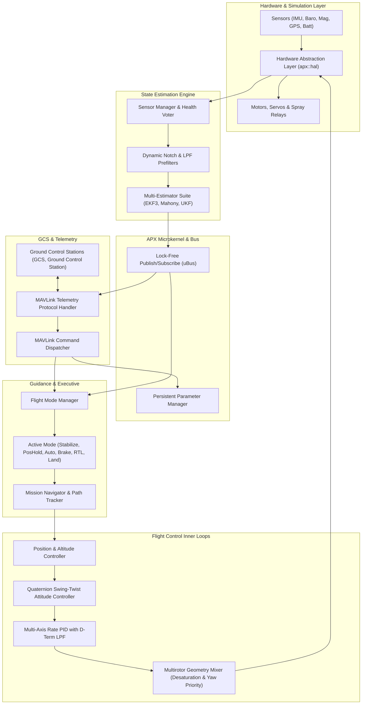
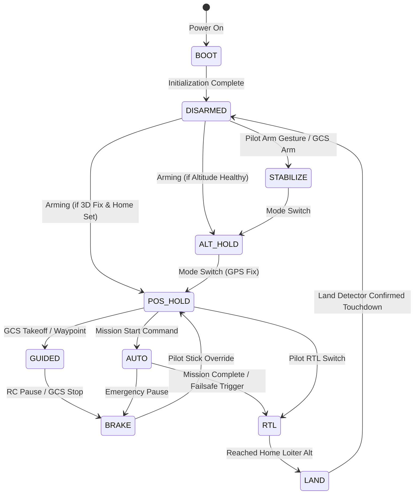
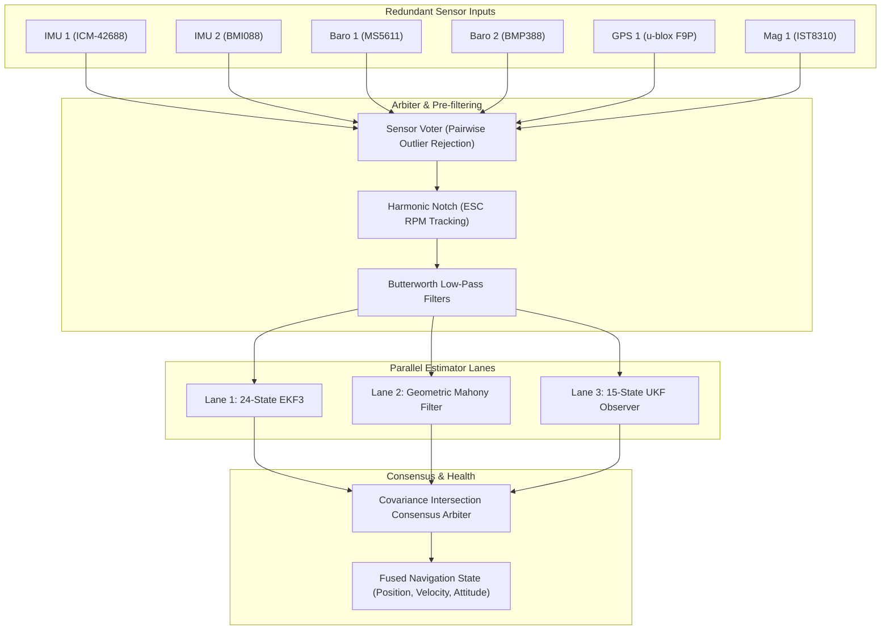

# APX Flight Controller Architecture

This document details the software architecture, execution flow, data pathways, and component interaction models of the APX autopilot platform.

---

## 1. System Overview

APX is an aerospace-grade, multi-platform autopilot written in modern C++17. The system is designed with strict separation between platform hardware drivers, estimation, vehicle guidance modes, inner-loop flight control, and ground communication.

---

## 2. Flight Control Cascade & Dynamics

The flight control cascade follows a four-tier nested feedback loop:

1. **Position & Velocity Loop:** Converts 3D position targets into horizontal velocity and vertical climb rates. Velocity demands are capped by `m_max_speed_ms` (`WPNAV_SPEED`) and converted into desired body tilt vectors.
2. **Attitude Control Loop (Swing-Twist Quaternion):** Decouples thrust-vector tilt (swing) from heading alignment (twist). This prevents large simultaneous yaw disturbances from destabilizing pitch/roll.
3. **Rate Control Loop:** Runs at 400 Hz. Computes torque setpoints using differentiated measurement derivatives \( \frac{d\omega}{dt} \) and dynamic low-pass filtering.
4. **Actuator Mixer:** Scales roll/pitch first, allocates remaining headroom to yaw authority, and performs whole-vector desaturation without asymmetric motor clipping.

---

## 3. Flight Mode State Machine

The `ModeManager` validates pre-arm requirements, handles pilot mode transitions, and executes mode lifecycle callbacks (`on_enter`, `update`, `on_exit`).

---

## 4. Multi-Estimator Fusion Architecture

APX incorporates a parallel estimator pipeline where multiple estimation algorithms execute simultaneously:

- **EKF3 (24-State Error-State Kalman Filter):** Full 3D navigation solution fusing IMU, GPS (including RTK), Barometer, and Magnetometer with online sensor bias learning.
- **Fast Geometric Observer (Mahony Filter):** Lightweight complementary filter providing backup attitude estimation when GPS or magnetometer degraded.
- **Unscented Kalman Filter (UKF):** High-dynamic turn tracker preventing Jacobian linearization singularity.
- **Sensor Voter & Health Arbiter:** Dynamically ranks sensor lanes (IMU1..4, Baro1..4) based on variance and innovation tests, switching streams seamlessly.

---

## 5. MAVLink Telemetry and Command Dispatch

Ground Station communication is completely asynchronous:

- Incoming MAVLink packets arrive over UART or UDP sockets.
- The `MavlinkHandler` decodes packets, updates parameter registers, and delegates mission items to `MissionExecutor`.
- Heartbeat packets broadcast standard custom mode identifiers (`0=STABILIZE`, `3=AUTO`, `4=GUIDED`, `17=BRAKE`, etc.) with standard custom dialect identification for universal GCS and Ground Control Station support.
- Actuator telemetry (including motor outputs and spray pump PWM on servo channel 9) is streamed in real time.
